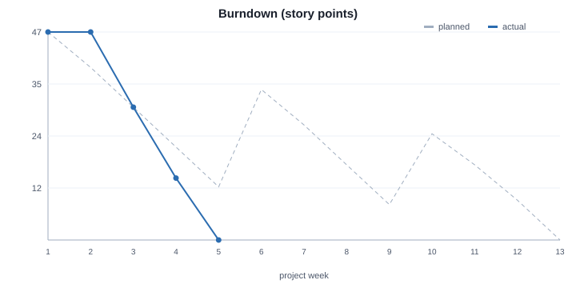
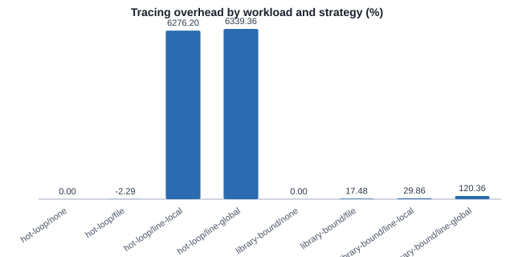

# Risk-Aware Test Selection, Prioritisation and Flakiness Triage for pytest

**Team name:** `<team name>` · **Project name:** `<project name>` · **Course:** CS5351 Software Engineering

**Members (student ID, not EID):**

| # | Name | Student ID |
| --- | --- | --- |
| 1 | `<name>` | `<id>` |
| 2 | `<name>` | `<id>` |
| 3 | `<name>` | `<id>` |
| 4 | `<name>` | `<id>` |
| 5 | `<name>` | `<id>` |
| 6 | `<name>` | `<id>` |

> Draft status.  Sections 1–9 are drafted with measured content produced by this
> repository.  Sections 10–12 (student bios, self-reflection, relative
> contribution) and the presentation material are the team's own work and are
> deliberately left as templates.  Figures are generated by the repository into
> `docs/report/figures/`; insert them into the IEEE TSE template at the marked
> positions.

---

## Abstract

Developers run a whole test suite to answer a local question: did this change
break anything?  Feedback latency therefore grows with the size of the suite
rather than with the size of the change, and naive skipping is worse than running
everything because it can hide a regression.  We present `pytest-risktest`, a
software engineering tool that observes which project files each test actually
executes (using PEP 669 low-impact monitoring), fuses that evidence with a static
import closure, run history and flakiness signals, and runs only the tests a change
can affect -- in risk order -- under an explicit safety budget.  On 36 verified
mutations across four targets (three generated layered projects and the tool's own
suite) the tool skipped 69–85 % of the suite while detecting every failing test
(worst-case recall 1.000, zero missed failures), raised the fault-detection order
from APFD 0.659 (full run) to 0.925, and saved 63–85 % of test execution time.
Observation overhead is within 20 % at file granularity.  We also report the
limits: line granularity can cost two orders of magnitude, and tests that cross a
process boundary are invisible to tracing -- the tool measures that blind spot and
provides an explicit escape hatch for it.

**Keywords:** test impact analysis, regression testing, test prioritisation, flaky
tests, Python, pytest, software engineering tool

---

## 1. Introduction

### 1.1 Background and motivation

Regression testing is the most repetitive activity in software development.  Every
commit in a growing project raises the same question: *which of my tests can this
change possibly affect?*  The default answer in practice is "all of them", which
makes the developer's feedback loop a function of suite size instead of change
size.  Continuous integration amplifies the problem: a suite that takes twenty
minutes turns a five-line edit into a twenty-minute wait, and the temptation to
merge without waiting grows accordingly.

Software engineering research and practice offer two families of answers.  *Test
impact analysis* (TIA) records which tests execute which code and re-runs only the
tests that touch a changed file.  *Predictive test selection* ranks tests by the
probability that they will fail and runs the most promising subset under a
confidence target.  Both are used in large industrial build systems; both have a
failure mode that matters more than speed: they can be wrong, and a wrong skip
decision is a regression that reaches production because the tool said "green".

This project builds a third-position tool: a TIA-based selector that is
*explainable* (every skip decision carries a reason), *bounded* (an explicit stop
rule caps how much of the suite may be skipped) and *conservative by construction*
(tests whose dependencies are unknown, previously failing or flaky are always
run).  The tool is delivered as a plug-in for `pytest`, the most widely used Python
test runner, which the course guidelines recommend as a starting point: it is an
operable open-source project with a documented plug-in API, and the problem it
addresses has a research literature behind it.

### 1.2 The problem we solve

We name the user, the workflow, the trigger and the failure:

* **User** -- a developer or an automated CI pipeline on a Python project whose
  test suite is large or slow.
* **Workflow** -- edit source, run tests, fix failures, push.
* **Trigger** -- a commit or a pull request that changes a small part of the code.
* **Current failure** -- the only available answer is to run everything, so the
  feedback latency is proportional to the suite, not to the change; and when teams
  do try to skip, they have no evidence for what is safe to skip.

Measured on the benchmark of this project, a single verified change affects 9–31 %
of the suite, yet the naive workflow executes 100 % of it.  The gap is the
opportunity; the risk is that closing it naively hides failures.

### 1.3 Our idea and solution in one paragraph

`pytest-risktest` observes, for every test, the set of project files that the test
really executed, and stores it together with per-file content digests.  On the
next run it computes which files changed, fuses three evidence sources -- observed
execution, the static import closure, and per-test run history including
flakiness -- and produces a selection plan with a reason per test.  The plan is
bounded by a stop rule (never skip more than a configurable share of the suite,
never run fewer than a configurable minimum) and by an always-run set (unseen
tests, new tests, previously failing tests, flaky suspects).  Selected tests are
ordered by an explainable risk score so that failures are detected earlier.  A
marker (`@pytest.mark.risktest_always`) exists for tests the model structurally
cannot see, such as tests that exercise the product through a subprocess.

### 1.4 Evaluation summary

We froze the evaluation contract before measuring (`docs/05-evaluation-contract.md`):
metrics (skip rate, recall, missed failures, APFD, wall-clock and execution-time
savings, observation overhead), four targets, a fault model in which a mutation
counts only if it provably breaks at least one test, and a protocol that restores
the tool's state between policy runs.  Across 36 mutation runs and three policies:

* **Safety.** Worst-case recall 1.000 with zero missed failures; no policy ever
  reported a green run while a real failure existed.
* **Effectiveness.** `fast` skipped 85.4 % of the suite on average, `balanced`
  71.4 %, `safe` 69.3 %.
* **Ordering.** APFD 0.925 with risk ordering versus 0.659 for the collection order
  of a full run.
* **Efficiency.** 63–85 % of test execution time saved; observation overhead
  within the frozen 20 % budget at file granularity.
* **Honesty.** Two negative results are reported with their mitigations: the cost
  of line granularity, and the process-boundary blind spot.

### 1.5 Contributions

1. An evidence-fusion selection engine with auditable policies and an explicit
   safety budget (stop rules plus always-run set).
2. A deferred, per-code-object line-instrumentation strategy built on PEP 669 that
   reduces line-tracing overhead from +97 % to −2 % on a library-dominated
   workload relative to interpreter-wide line events.
3. An explainable, model-free prioritisation function, and a differential
   flakiness signal that needs one perturbed rerun instead of many.
4. A reproducible evaluation harness with verified mutations, an untraced ground
   truth, a self-hosted target, and three dedicated experiments -- including one
   that measures where the approach fails.

### 1.6 Report organisation

Section 2 reviews related work and the open-source base.  Section 3 gives the
technical preliminaries (PEP 669, the pytest plug-in API, TIA and APFD, flakiness).
Section 4 presents the solution, its algorithms, its architecture and a worked
example.  Section 5 documents the software process, sprint by sprint.  Section 6
presents the evaluation.  Section 7 discusses threats to validity.  Section 8
concludes.  Sections 9–11 contain the student bios, self-reflections and the
relative-contribution table.  All artefacts referenced here are in the project
repository.

---

## 2. Related Work

### 2.1 Test impact analysis in build systems

TIA has been implemented in build systems for two decades: the build tool records
which test executed which artefact and re-runs the affected tests after a change.
The idea scales because the dependency evidence is produced by the ordinary test
run, not by a separate analysis.  Its weakness is inheritance: a test that has
never executed a file -- because the file is new, because the test was skipped
last time, or because it reaches the code through a process boundary -- has no
edge to that file, and the change is invisible.  Our tool keeps the same core idea
but makes the incompleteness explicit: unseen and untraceable tests are always
run, the static import closure is available as a second, conservative signal, and
the residual blind spot is measured and documented.

### 2.2 Predictive test selection

Large organisations rank tests by predicted failure probability using features
such as change history, test history, and the size of the change, and then run a
subset under a confidence target.  These systems show substantial cost reduction
at high recall, but they are typically opaque: the ranking comes from a trained
model and the developer cannot see why a specific test was skipped.  We keep the
feature-driven idea and drop the model.  Our risk score is a documented weighted
sum over observable state (last outcome, failure rate, flakiness flag, whether the
test executed the changed file, how many changed lines it touched, and how close
it is in the static closure), which makes every ordering reproducible from the
store, and it can be audited line by line in the run report.

### 2.3 Coverage-based selection for pytest

`pytest-testmon` is the closest open-source tool for our ecosystem: it records
per-test coverage and re-runs the tests affected by changed files.  Our work
differs in four ways: (i) we use PEP 669 monitoring rather than a full tracer and
measure the resulting overhead; (ii) we fuse observed execution with a static
import closure and expose the trade-off as named policies; (iii) we add
prioritisation, differential flakiness detection and stop rules; (iv) we evaluate
with a frozen contract, including an experiment that shows where the approach
breaks.

### 2.4 Flaky test detection

The dominant technique in the literature is order perturbation: re-run the same
tests in different orders (or with different parallelism/scheduling) and inspect
which outcomes flip.  It is effective but expensive, because it multiplies the
suite cost -- exactly what a time-saving tool cannot afford.  We therefore use two
signals: a *differential* signal that costs nothing extra (the same dependency
fingerprint produced a different outcome, so the code under test did not change),
and an on-demand perturbed rerun (`risktest flaky-check`) for confirmation.
Flaky suspects are added to the always-run set, so the tool never hides a failure
behind the tool's own notion of "probably flaky".

### 2.5 Software engineering body of knowledge and AI-assisted development

SWEBOK v4.0 frames our process choices: the tool targets one knowledge area
(software testing) inside a development workflow, and the repository carries the
artefacts of the surrounding process (requirements, design decisions, verification,
maintenance).  DORA's 2025 report on AI-assisted development informs our working
practice: AI assistance amplifies the surrounding delivery system, so the project
keeps a written coding-agent contract (bounded tasks, mandatory tests and
rationale, human ownership) and makes test evidence visible at review time through
a CI status check.  NIST SP 800-218 (secure software development) and the NIST AI
Risk Management Framework inform the risk register: each risk has a trigger, an
owner, a mitigation and a decision date, and the tool itself is designed to fail
closed (absorbing its own errors into a full run rather than into a skip).

### 2.6 Open-source base selection

We compared candidate bases (pytest, ESLint, JVM build plug-ins, static-analysis
platforms, log-analysis libraries) on three criteria: a documented plug-in
boundary, research backing, and the availability of an objective evaluation signal
that runs offline.  pytest won on all three: the `pytest11` entry point and
collection/run hooks give exactly the extension points a selection tool needs, the
ground truth of a run (per-test pass/fail and duration) needs no labelling effort,
and the whole evaluation can be reproduced with a single command without network
access.  The full comparison, including the rejected candidates and why, is in
`docs/02-open-source-base-and-related-work.md`.

---

## 3. Preliminaries

### 3.1 The pytest plug-in model

A pytest plug-in registers hook implementations.  Three hooks carry this project:

* `pytest_collection_modifyitems(config, items)` -- runs after collection; the
  plug-in may reorder `items` and deselect tests (reporting them through
  `pytest_deselected` so the user sees the number of deselected tests);
* `pytest_runtest_setup` / `pytest_runtest_teardown` -- bracket the execution of
  one test, including fixtures;
* `pytest_runtest_logreport` / `pytest_sessionfinish` -- provide per-phase
  outcomes, durations and the end of the session, where state is persisted.

A plug-in distributed as a package declares an entry point
(`[project.entry-points.pytest11]`); during development it is loaded explicitly
with `-p pytest_risktest.plugin`, which is how the tests and the benchmark drive
it.

### 3.2 PEP 669: low-impact monitoring

CPython 3.12 introduced `sys.monitoring`, a mechanism for tools to subscribe to
interpreter events (function entry, line execution, jumps, calls, returns,
exceptions) with much lower cost than `sys.settrace`.  A tool acquires one of a
small number of tool ids, registers callbacks per event type, and enables events
either globally (`set_events`) or per code object (`set_local_events`).  Returning
`sys.monitoring.DISABLE` from a callback disables that event at that location
until `restart_events()` re-arms it.

Two properties matter for this project.  First, *the cost is proportional to the
events the tool asks for*: function-entry events are cheap for tight loops,
line events are not.  Second, *events are per code object*, which makes it possible
to instrument only the project's own code and to leave the framework, the standard
library and third-party packages alone.  Section 4.2 turns the second property
into the tool's default line strategy.

### 3.3 Test impact analysis, recall and APFD

Let `T` be the test suite and `F ⊆ T` the tests that a given change really breaks.
A selection strategy produces an executed set `E ⊆ T`.

* **Skip rate** = 1 − |E| / |T| -- how much work was avoided.
* **Recall** = |E ∩ F| / |F| -- how much of the truth was observed.  Recall is the
  safety metric; a single missed failure is a false green.
* **APFD** (Average Percentage of Faults Detected) measures how early an ordering
  reveals failures: for `m` failing tests among `n` tests, with `TF_i` the position
  of the first test in the order that reveals fault `i`,

  `APFD = 1 − (Σ TF_i) / (n · m) + 1 / (2n)`.

  APFD is 1 only in the limit; with `m` faults the best achievable value is
  `1 − m/(2n)`.  We use the full test set as the universe `n` so that a failure
  that was never executed is penalised as detected last, never as detected.

### 3.4 Dependency fingerprints and differential flakiness

For a test `t` and its observed dependency set `D(t) = {file → lines}`, the
*fingerprint* is a hash of the sorted (path, content digest, line set) triples:

`fp(t) = H( sort( [ (path, digest(path), lines) for path ∈ D(t) ] ) )`.

If a test fails although `fp(t)` is identical to a run in which it passed, then
nothing in the code under test explains the flip: the test itself is not
deterministic.  This *differential* signal needs no extra execution, in contrast
to the order-perturbation reruns used in the literature, which multiply suite cost.

### 3.5 Change detection without a version-control system

The tool must work in environments where git is unavailable or where the working
tree is dirty.  It therefore keeps a per-file digest and a per-line digest vector
in its store, gated by `(size, mtime_ns)` so that unchanged files are not
re-hashed; the changed-line set is computed with an LCS diff (`difflib`) only for
files whose content digest changed.  A change to build or test configuration
(`pyproject.toml`, `pytest.ini`, `tox.ini`, `setup.cfg`, requirements files) is
treated as a global invalidation and forces a full run.

---

## 4. Solution

### 4.1 Overview

`pytest-risktest` is a pytest plug-in with nine modules.  A run has four phases:
*observe* (what did each test execute?), *decide* (which tests can the change
affect, and in which order?), *run*, and *report* (why was each test selected,
what happened, what does the tool know now?).

| Module | Responsibility |
| --- | --- |
| `monitor.py` | per-test dependency collection on PEP 669; file and line granularity; two line strategies |
| `graph.py` | static import graph and reverse-dependency closure |
| `store.py` | SQLite persistence: digests, line hashes, dependency edges, per-test outcomes, fingerprints |
| `selector.py` | change detection, evidence fusion, policies, stop rules, risk score, ordering |
| `flaky.py` | differential flakiness and order-perturbation verdicts |
| `metrics.py` | APFD, recall, skip rate, savings, aggregation (the frozen metrics) |
| `report.py` | JSON / Markdown / HTML reports, inline SVG charts |
| `plugin.py` | pytest hooks: options, selection, tracing, persistence, terminal summary |
| `cli.py` | `risktest status / impact / flaky-check / report / clean` |

### 4.2 Observation: what did the test execute?

For every test, the plug-in enables monitoring in `pytest_runtest_setup` and
disables it in `pytest_runtest_teardown`, so fixtures and the test body are
attributed to the test and collection or idle time is not.  Only files inside the
project root are recorded (with `.git`, `.venv`, `__pycache__`, `node_modules`,
`build`, `dist` excluded), keyed by a POSIX relative path so that the store is
portable.

Two granularities are available:

* **file** (default): one `PY_START` event per executed function; a tight loop in
  one function costs one callback rather than one per iteration.
* **line** (opt-in): `LINE` events, which additionally allow the selector to
  distinguish "the test executed the changed *lines*" from "the test executed the
  changed *file*".

**Algorithm 1 -- deferred local line instrumentation (the default line strategy).**

```
on_event_start():
    restart_events()                     # re-arm locations disabled in earlier tests
    set_events(tool, PY_START)           # global: function entry only

on_py_start(code, offset):
    if no test is active or code is outside the project: return
    record file(code) for the active test
    if granularity == line and code not yet instrumented:
        mark code as instrumented
        set_local_events(tool, code, LINE)   # this code object only
        return DISABLE                       # the entry event is now redundant

on_line(code, line):
    if a test is active and code is inside the project:
        record (file(code), line) for the active test

on_event_end():
    for code in instrumented: set_local_events(tool, code, 0)   # set_events(0) does not do this
    clear instrumented
    set_events(tool, 0)
```

The design matters because `set_events(tool, 0)` clears only the *global* event
set: local events keep firing until they are cleared explicitly, so the monitor
releases every instrumented code object at the end of each test.  Section 6.4
quantifies what this buys.

### 4.3 Change detection

At collection time the plug-in reads the previously stored digests, refreshes them
(re-hashing only files whose size or mtime changed), and computes three sets:
`changed`, `added`, `removed`.  Configuration files that changed force a full run,
because the dependency model cannot represent a changed build or test
configuration.  Three change-detection modes are supported: `hash` (no git
required, the default fallback), `git` (`git diff --name-only <base>`), `auto`
and `none`.

### 4.4 Decision: fusing evidence into a selection plan

Let `C` be the changed (and added) Python files, and for a test `t` let `D(t)` be
its observed dependency set, `S(t)` the set of files statically reachable from the
test's module through imports, and `H(t)` its history (last status, failure rate,
flakiness flag, always-run flag).

**Algorithm 2 -- selection under a policy.**

```
plan_selection(all_tests, store, graph, policy, change, ...):
    if policy.select == false:            # policy "off": trace-only
        return every test, reason = policy-off
    if change touches configuration:
        return every test, fallback = "configuration files changed"

    selected, reasons = {}, {}
    for file in change.changed:                       # dynamic evidence
        for test in store.tests_touching(file):
            selected += test
            reasons[test] = "changed-line" if granularity == line
                            and executed-lines(test) ∩ changed-lines(file) ≠ ∅
                            else "changed-dependency"

    for file in graph.affected_by(change.changed, policy.depth):   # static evidence
        for test in store.tests_touching(file):
            selected += test; reasons.setdefault(test, "transitive-dependency")

    if policy.include_always:                          # safety net
        for test in all_tests:
            if test unknown or has no recorded dependencies: add reason "new-test"/"unknown-dependency"
            elif always_run(test):                           add reason "always-run"
            elif flaky(test):                                add reason "flaky-suspect"
            elif failed-last-run(test):                      add reason "previous-failure"

    for test in forced_by_marker(all_tests):            # escape hatch
        selected += test; reasons[test] = "always-run"

    # stop rule: never deselect more than max_deselect_pct of the suite
    floor = max(min_selected, ⌊|all_tests| · (1 − max_deselect_pct/100)⌋)
    while |selected| < floor: add highest-failure-rate test not yet selected

    order selected by risk score (descending)
    return plan with selected, deselected, reasons, risk, change
```

Policies are data, not code:

| Policy | Static closure depth | Always-run set | Intended use |
| --- | --- | --- | --- |
| `off` | — | — | warm-up / trace-only baseline |
| `fast` | 0 | yes | local iteration, maximum saving |
| `balanced` | 1 hop | yes | default; cheap conservative margin |
| `safe` | full closure | yes | CI gate; recommended in the report |

**Risk score.**  The score used for ordering is a documented weighted sum:
`3·[last run failed] + 2·[flaky] + failure_rate + 1.5·[changed-dependency]
+ 1.0·[changed-line] + 0.5·[transitive-dependency] + 0.4·[always-run|previous-failure]
+ 0.5·min(1, changed-lines-touched / total-changed-lines)`, with a deterministic
tie-break on the node id.  It is deliberately simple: the APFD result in Section
6.3 comes from observable state that a reviewer can recompute from the store.

### 4.5 Flakiness triage

Two signals produce a verdict per test:

* **differential** -- the current outcome contradicts an outcome recorded under an
  identical dependency fingerprint (no code change can explain the flip);
* **order-dependent** -- two runs of the same test set with the same fingerprints
  but different seeded orders disagree (`risktest flaky-check` performs the second,
  perturbed run on demand).

Either verdict sets the flaky flag, which adds the test to the always-run set.  The
flag is never used to *ignore* a failure -- only to stop trusting the test's own
outcome as evidence about the change.

### 4.6 Reporting

Each run writes a JSON report (machine-readable), a Markdown summary and a
self-contained HTML page with inline SVG charts.  The report contains the policy
and granularity, the change set, the reason histogram, the selected and deselected
tests, the per-test risk scores, outcomes and durations, flakiness findings,
monitor statistics and any degradation warning.  The same payload is what the
benchmark consumes, so the numbers in this report and in the tool's output cannot
diverge.

### 4.7 Worked example

The generated subject `subject_02` has 88 tests: 24 for the core (math/strings/
store/validation/billing/catalog/reports) and 64 in eight generated feature
modules, each of which imports the math helpers.

1. **Warm-up.** `pytest -p pytest_risktest.plugin --risktest --risktest-policy=off`
   executes all 88 tests and records 88 dependency sets (e.g. `test_feature_03`
   depends on `app/features/feature_03.py`, `app/core/mathx.py`, `tests/support.py`).
2. **A local change.** A mutation in `app/features/feature_02.py` breaks three
   tests.  All three policies select exactly the eight tests of
   `tests/test_feature_02.py` (skip rate 0.909), detect all three failures
   (recall 1.000) and save 88 % of test execution time.
3. **A core change.** A mutation in `app/core/mathx.py` breaks two tests that live
   in different modules.  `fast` selects the 34 tests whose traces include the
   file (skip rate 0.614); `balanced` adds one hop of importers (69 tests, 0.216);
   `safe` adds the whole closure (80 tests, 0.091).  All three detect both
   failures; the extra tests are the price of conservatism, and the report shows
   exactly which reason added each of them.
4. **A new test.** `tests/test_new.py` is added and immediately fails.  It has no
   recorded dependencies, so it is selected with reason `new-test` before any
   trace exists.
5. **A subprocess test.** A test that runs the product in a child process has no
   edge to the product's file, so the mutation is invisible; after adding
   `@pytest.mark.risktest_always` the test is selected and the failure is found
   (Section 6.5).

---

## 5. Software Process

The project follows Scrum with three four-week sprints, weekly standing meetings,
and a repository that carries the evidence of each week (`docs/process/`).  The
burndown chart for the whole project is generated from
`docs/process/burndown.csv` (`docs/report/figures/burndown.svg`); weeks without
recorded actuals are left empty on purpose, because a burndown is evidence.



### 5.1 Sprint 1 (weeks 2–5): walking skeleton

**Goal.** Observe dependencies on a real pytest run and use them to run only the
affected tests, with the safety net in place from the first sprint.

**Delivered.** The PEP 669 monitor (file granularity, later extended with the
deferred local line strategy), the static import graph, the SQLite store with
digest caching and change detection without git, the selection engine with
policies, the always-run set and the stop rules, the pytest plug-in, the CLI, the
first 95 automated tests, the benchmark harness, and the process documents
(requirements, ADRs, evaluation contract, risk register).

**Activities.** Stories were estimated in story points and tracked as issues; the
team reviewed the design of the dependency store and the selection engine as a
group; the evaluation contract was frozen *before* the first comparison, which is
why two methodological defects could be identified without post-hoc rationalisation:

* the first mutation generator produced changes that no test detected, which would
  have made recall a meaningless 1.0; the harness now retries until a mutation
  provably kills at least one test;
* the first harness let the three policy runs share the tool's state, so the second
  policy saw an unchanged tree; the harness now restores a store snapshot before
  every policy run.

Both defects are recorded in the risk register (R-7) with the fix, because a
deleted mistake is not evidence of learning.

**Review outcome.** Two decisions were taken and recorded as ADRs: file
granularity is the product default (ADR-3), and the selection must never be able
to hide a failure (ADR-5, ADR-6).

### 5.2 Sprint 2 (weeks 6–9): code quality, prioritisation, flakiness

**Goal.** Turn the working skeleton into a tool a reviewer would trust: an
explainable ordering, a flakiness story, and code quality measures.

**Delivered.** The risk score and ordering (with APFD evidence), differential
flakiness detection plus `risktest flaky-check`, the policies-as-data refactor, the
self-hosted benchmark target, and the reading notes behind Section 2.

**Code-quality activities.**  Public functions carry type hints, modules carry
"why" docstrings, private helpers are underscored, the exception paths are
documented rather than empty (`except Exception` only where the plug-in must not
break a user's run), and the review checklist in
`docs/07-coding-agent-contract.md` is applied to every change.  The team also
removed a duplicated change-detection function after review instead of leaving two
code paths that could drift apart.

**Review questions carried into sprint 3.** Does prioritisation raise APFD on
every target or only on average?  Can the flakiness signal produce a false
positive, and what does one perturbed rerun cost?  Is the remaining code small
enough that every member can read it?

### 5.3 Sprint 3 (weeks 10–13): automated testing, maintenance, wrap-up

**Goal.** Make the evidence reproducible by anyone: automated end-to-end tests in
CI, a boundary experiment, maintenance commands, a frozen evaluation re-run, and
the report and presentation.

**Delivered (state of this draft).** Ten end-to-end tests that drive the plug-in
through real subprocesses (selection, safety, stop rule, marker, configuration
change, report formats, CLI), the CI workflow with unit, integration and
benchmark-smoke jobs, the line-strategy experiment, the untraced-path experiment,
`risktest status/report/clean` for maintenance, and the full evaluation.

**Process improvement the team made.** The first benchmark was "run the tool and
report the skip rate".  After noticing how easily such a measurement flatters the
tool, the team adopted a stricter protocol: an untraced ground truth, verified
mutations, a store snapshot between policies, and a published work factor for the
generated subjects.  The reporting also changed: every claim now carries the
command that reproduces it.

---

## 6. Evaluation

### 6.1 Research questions and frozen contract

The contract (metrics, targets, fault model, protocol, thresholds) is frozen in
`docs/05-evaluation-contract.md` and was fixed before the measurements below.

* **RQ1 effectiveness** -- how much of the suite can be skipped while detecting
  every failure the change caused?
* **RQ2 efficiency** -- how much execution time is saved, and what does observation
  cost?
* **RQ3 ordering** -- does risk ordering reveal failures earlier than the
  collection order of a full run?
* **RQ4 limits** -- where does the approach fail?

**Targets.** Three generated layered subjects (88 tests each, core / store /
services / eight feature modules, ~15 ms of real CPU work per test, published
knob) and this project's own unit suite (79 tests, no artificial work factor).

**Fault model.** Four mutation operators (operator replacement, constant change,
condition negation, return-value neutralisation).  A mutation is accepted only if
it provably breaks at least one test; ground truth is always a plain, untraced
pytest run with JUnit XML.  The self-hosted target mutates only the two modules
that the selection path does not use, so the mutation cannot change the tool being
measured.

### 6.2 RQ1: how much can be skipped safely?

36 runs (4 targets × 3 accepted mutations × 3 policies):

| Policy | runs | mean skip rate | worst-case recall | missed failures | mean time saved | mean work saved |
| --- | --- | --- | --- | --- | --- | --- |
| fast (dynamic only) | 12 | 0.854 | 1.000 | 0 | 0.180 | 0.851 |
| balanced (+1 hop, default) | 12 | 0.714 | 1.000 | 0 | 0.124 | 0.656 |
| safe (full closure) | 12 | 0.693 | 1.000 | 0 | 0.105 | 0.634 |

All three policies satisfied the frozen threshold (`skip rate ≥ 0.35`, recall
1.000, zero misses).  The interesting result is *where* the conservative policies
spend their budget: on the 30 mutation runs whose change was local, all three
policies selected the same small set (skip rate 0.909); on the six runs where a
core module changed, `fast` selected 34 tests (0.614), `balanced` 69 (0.216) and
`safe` 80 (0.091) -- and all three still detected every failure.  The static
closure therefore bought no *recall* on this benchmark; it buys protection against
the situations the benchmark does not contain (stale traces, first runs after a
rebase, new test files) and it is the reason the tool can be recommended as a CI
gate rather than as a local convenience.


### 6.3 RQ3: does ordering help?

| Order | mean APFD |
| --- | --- |
| full run, collection order (baseline) | 0.659 |
| tool selection, risk order | 0.925 |

The improvement comes from running the tests that executed the changed file first,
weighted by their failure history and flakiness.  APFD is identical across the
three policies (0.925) because none of them missed a failure and they share the
same ordering function: APFD measures the *order*, while the skip rate measures
the *selection*.  We state this explicitly instead of presenting the highest
number as a policy comparison.


### 6.4 RQ2: what does the observation cost?

| Target | tests | untraced | traced (file) | traced (line) | overhead file | overhead line |
| --- | --- | --- | --- | --- | --- | --- |
| subject_01 | 88 | 1.486 s | 1.359 s | 9.043 s | −8.5 % | +508 % |
| subject_02 | 88 | 1.407 s | 1.402 s | 8.883 s | −0.3 % | +532 % |
| subject_03 | 88 | 1.362 s | 1.470 s | 8.864 s | +7.9 % | +551 % |
| this project's suite | 79 | 1.875 s | 2.189 s | 2.365 s | +16.7 % | +26 % |

File granularity stays inside the frozen 20 % budget on every target, including
the suite with no artificial work factor.  Line granularity exceeds it by a factor
of five on the CPU-bound subjects, because the generated tests spend their time in
loops inside project code, where every iteration pays a line callback.

The design-option experiment (same workload, four strategies) explains when the
deferred local instrumentation from Algorithm 1 pays off:

| Workload | strategy | overhead |
| --- | --- | --- |
| tight loop in project code (worst case) | file | +3.0 % |
| | line, local | +6170 % |
| | line, global | +6046 % |
| loop dominated by standard-library code | file | +3.6 % |
| | line, **local** | **−2.3 %** |
| | line, global | +97.2 % |

When the hot code is library code, per-code-object instrumentation is ~40× cheaper
than interpreter-wide line events, because library code objects are never
instrumented.  When the hot code is the project's own code, no strategy helps --
which is exactly why file granularity is the default (ADR-3) and line granularity
is an opt-in mode.




### 6.5 RQ4: where does it fail?

**Process boundaries.**  A test that exercises the product through
`subprocess.run` never executes the product's code in the instrumented
interpreter, so no dependency edge exists:

| Phase | selected | executed | real failures | detected | missed |
| --- | --- | --- | --- | --- | --- |
| no declaration (dynamic tracing only) | 1 | 1 | 2 | 1 | **1** |
| with `@pytest.mark.risktest_always` | 2 | 2 | 2 | 2 | 0 |

The miss is real and is reported as such.  The mitigation is a first-class feature
(ADR-6): the marker is honoured independently of the policy and of the stop rule,
and the documentation requires process-boundary tests to declare themselves.  The
stop rule limited the damage in the experiment (it still ran one test), which is
its purpose: bound the blast radius of a wrong model.

**Wall-clock savings are modest on small suites.**  The fixed cost of starting an
interpreter and importing pytest is 1.3–2.2 s on the benchmark machine, so
`time_saved` is 10–18 % while `work_saved` (test execution time only) is 63–85 %.
Both are reported; the wall-clock number is the honest end-to-end one, and the
execution-time number is the one that scales with suite length.

**The tool must run once per change.**  Running it twice on an unchanged tree
selects only the always-run set (bounded by the stop rule).  This is by design --
the tool answers "what does *this* change require?" -- and it is why the benchmark
restores the store between policy runs instead of running three policies
back-to-back.

### 6.6 Thresholds

| RQ | Frozen threshold | Result | Met |
| --- | --- | --- | --- |
| RQ1 | mean skip rate ≥ 0.35 for the recommended policy, recall 1.0, zero misses in every run | 0.693 / 1.000 / 0 | yes |
| RQ2 | observation overhead < 20 % at file granularity on work-carrying suites | −8.5 %…+16.7 % | yes |
| RQ3 | tool APFD > baseline APFD | 0.925 > 0.659 | yes |
| RQ4 | at least one reproduced failure mode with a designed mitigation | process boundaries, measured and mitigated | yes |

---

## 7. Threats to Validity

**Internal validity.**  The benchmark's own defects were the largest threat we
observed: mutations that killed no test, and policy runs sharing state.  Both were
found by inspecting the first results, fixed in the harness, and recorded in the
risk register.  The current protocol uses an untraced ground truth for every
mutation, verifies that each accepted mutation kills at least one test, and
restores the tool's state before every policy run.  Timing measurements come from
a shared laptop; single measurements per configuration are noisy (visible as small
negative overhead values), so we draw conclusions only from effects larger than
that noise.

**External validity.**  The subjects are small (79–88 tests) and three of the four
are generated.  Generated subjects share one architecture shape (layered,
feature-per-module), and the fault model uses one mutation at a time from four
operators, so real multi-line or semantic regressions may behave differently.  The
work factor of ~15 ms per test is a knob that makes wall-clock effects visible;
real suites with different cost distributions may see different savings.  The
self-hosted target partially mitigates this: it is a real suite with real imports
and no artificial work factor.  A larger study should include third-party Python
projects with their own test suites.

**Construct validity.**  Recall and skip rate are only meaningful if the ground
truth is correct, which is why ground truth always comes from a plain pytest run
and never from the tool.  APFD assumes that failures are equally important and
that their order within a run matters; we use it as one signal among four and we
report the fact that APFD is insensitive to selection differences when no failure
is missed.

**Conclusion validity.**  With 12 runs per policy, the reported differences in skip
rate between policies are dominated by the six core-module mutations, which we
report explicitly.  The safety claim (recall 1.000, zero misses) is a claim about
this benchmark, not a proof; the boundary experiment shows precisely where the
claim ends.

---

## 8. Conclusion

We built `pytest-risktest`, a pytest plug-in that answers the everyday question
"what does this change require me to re-test?" with evidence instead of intuition.
The tool observes which files each test really executes using PEP 669 monitoring,
fuses that observation with a static import closure, run history and flakiness
signals, and produces a selection plan in which every decision carries a reason.
It never trusts itself more than a configured safety budget allows: a stop rule
limits the skip rate, an always-run set covers unseen, failing and flaky tests, and
an explicit marker covers the code paths that tracing structurally cannot see.

On 36 verified mutations across four targets, the recommended policy skipped 69 %
of the suite, detected every failure the changes caused, and improved the
fault-detection order from APFD 0.659 to 0.925 while saving 63 % of test execution
time; the more aggressive policy skipped 85 % with the same recall.  Observation
at file granularity stays inside a 20 % budget, and the line-tracing experiment
shows that the deferred per-code-object strategy reduces overhead from +97 % to
−2 % when execution is library-dominated -- a result we would not have obtained
without measuring the design options.

The project's most valuable artefacts are arguably not the numbers but the
discipline behind them: a frozen evaluation contract, an untraced ground truth,
mutation acceptance by proof, state restoration between policies, and two reported
negative results with mitigations.  The remaining work is to run the tool on
third-party projects, to extend the fault model beyond single-line mutations, and
to keep the dependency evidence fresh for tests that are deselected for several
consecutive runs -- the one place where staleness can still cost recall.

---

## 9. Student Bios and Self-Reflection

> Template -- each student writes their own paragraph.  For every member:
>
> * who you are and your background (courses, interests, tools you already used);
> * your technical ideas in this project (what you proposed, what you rejected and why);
> * your current interests (topics you would like to work on next);
> * a self-reflection on the work you did: what you are proud of, what you
>   underestimated, what you would do differently;
> * a statement of your contribution to the project, consistent with Section 11.

### `<Name>` (`<id>`)

`<bio, ideas, interests, self-reflection, contribution statement>`

### `<Name>` (`<id>`)

`<...>`

---

## 10. Relative Contribution

Use the same measure for every member (productive hours or story points) and
justify it with the weekly evidence in `docs/process/weekly-evidence.md`.
The course pro-rates marks with this table; the arithmetic below is the format
required by the course, with the team's numbers to be filled in.

| Member | Sprint 1 | Sprint 2 | Sprint 3 | Total | Share = total / mean |
| --- | --- | --- | --- | --- | --- |
| `<name>` | | | | | |
| `<name>` | | | | | |
| `<name>` | | | | | |
| `<name>` | | | | | |
| `<name>` | | | | | |
| `<name>` | | | | | |
| **Mean** | | | | | |

Worked example of the pro-rating (course rule): project mark 69 (B+ band
[66.5, 69.5)); members with totals 60, 55, 35 give a mean of 50, so shares are
1.2, 1.1 and 0.7 and the resulting marks are 82.8 (A+), 75.9 (A) and 48.3 (C).

---

## References

[1] IEEE Computer Society, *Guide to the Software Engineering Body of Knowledge
(SWEBOK Guide), Version 4.0*, 2024.

[2] DORA, *2025 State of AI-assisted Software Development*, Google Cloud, 2025.

[3] NIST, *SP 800-218: Secure Software Development Framework (SSDF) Version 1.1*,
2022.

[4] NIST, *Artificial Intelligence Risk Management Framework (AI RMF 1.0)*,
NIST AI 100-1, 2023.

[5] GitHub Docs, *Using Copilot coding agents* and *About status checks*.

[6] GitHub, *Spec Kit: specification → plan → task workflow for bounded
implementation*.

[7] pytest development team, *pytest documentation: plug-in API, hooks and
`pytest11` entry points*.

[8] CPython documentation, *`sys.monitoring` -- low impact monitoring* (PEP 669).

[9] M. Machalica, A. Samylkin, M. Porth, and S. Chandra, "Predictive Test
Selection," *Proc. Int. Conf. Software Engineering (ICSE)*, 2020.

[10] A. Memon, Z. Gao, B. Nguyen, S. Dhanda, E. Nickell, R. Siemborski, and
J. Micco, "Taming Google-Scale Continuous Testing," *Proc. ICSE-SEIP*, 2017.

[11] W. Lam, R. Oei, A. Shi, D. Marinov, and T. Xie, "iDFlakies: A Framework for
Detecting and Partially Classifying Flaky Tests," *Proc. ICST*, 2019.

[12] G. Rothermel and M. J. Harrold, "A Safe, Efficient Regression Test Selection
Technique," *ACM TOSEM*, 1997.

[13] S. Elbaum, A. G. Malishevsky, and G. Rothermel, "Test Case Prioritization: A
Family of Empirical Studies," *IEEE TSE*, 2002.

[14] pytest-testmon documentation, *selecting tests affected by recent changes*.

[15] `pytest-risktest` repository, `docs/05-evaluation-contract.md`,
`benchmark/results/` and `docs/04-architecture.md` (all measurements in this
report are reproducible from these artefacts).

---

## Appendix A -- Artefact index

| Artefact | Path |
| --- | --- |
| Tool source (2 212 lines) | `src/pytest_risktest/` |
| Tests (95) | `tests/` |
| Benchmark harness | `benchmark/run_bench.py`, `benchmark/mutate.py`, `benchmark/generate_subjects.py` |
| Raw results | `benchmark/results/{benchmark.csv,benchmark.json,summary.md}` |
| Experiments | `benchmark/experiments/{tracing_strategies.py,untraced_paths.py}` |
| Figures | `docs/report/figures/*.svg` |
| Requirements and NFRs | `docs/03-requirements.md` |
| Architecture decisions | `docs/04-architecture.md` |
| Evaluation contract | `docs/05-evaluation-contract.md` |
| Risk register | `docs/06-risk-register.md` |
| Process evidence | `docs/process/` |

