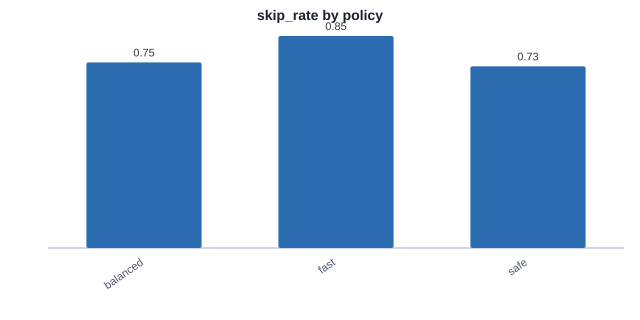
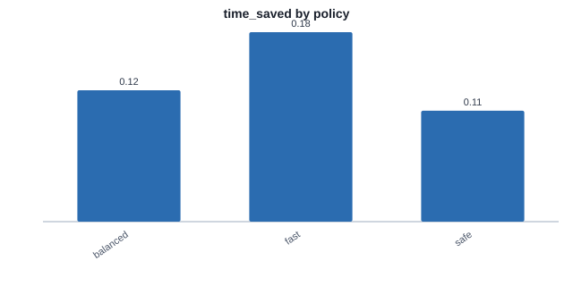
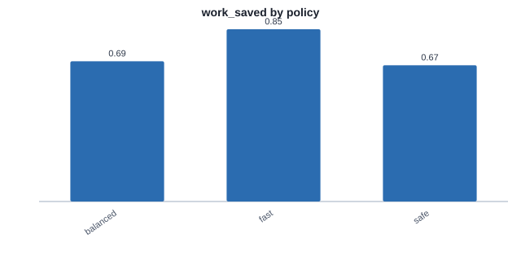
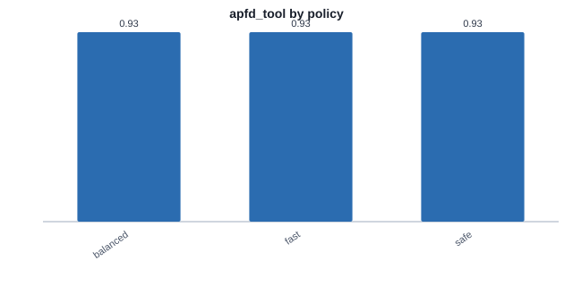
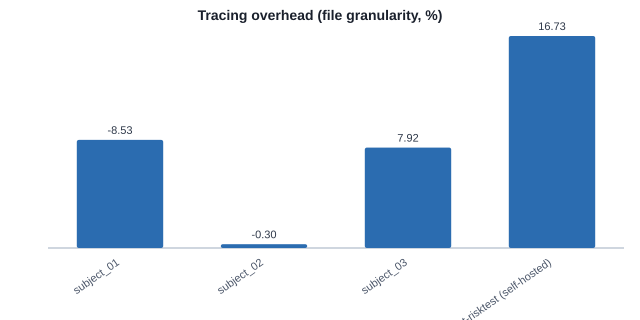

# Risk-Aware Test Selection, Prioritisation and Flakiness Triage for pytest

**Team name:** `Code Group 18 Default` · **Project name:** `pytest-risktest` (project number 18) · **Course:** CS5351 Software Engineering

**Members (student ID, not EID):**

| # | Name | Student ID |
| --- | --- | --- |
| 1 | 赵尊 (Zhao Zun) | 72610823 |
| 2 | 代佳乐 (Dai Jiale) | 72612080 |
| 3 | 肖宇 (Xiao Yu) | 72610896 |
| 4 | 张力元 (Zhang Liyuan) | 72610454 |
| 5 | 庄志洋 (Zhuang Zhiyang) | 72610571 |
| 6 | 周浩然 (Zhou Haoran) | 72610429 |

> Report status (2026-11-27).  The technical sections use the frozen 48-run
> evaluation from PR #13.  Sections 9 and 10 contain the six members' own
> biographies and self-reflections (translated where necessary) and the accepted
> contribution-hour allocation.  The IEEE-style two-column Word and PDF versions
> are generated as `docs/report/pytest-risktest-report.docx` and
> `docs/report/pytest-risktest-report.pdf`; final checks are recorded in
> `docs/report/report-checklist.md`.

---

## Abstract

Developers run a whole test suite after a small change, so feedback
latency grows with suite size rather than change size.  Skipping tests without
evidence can hide regressions.  We present `pytest-risktest`, a pytest plug-in
that uses PEP 669 monitoring to observe which project files each test executes,
fuses that evidence with a static import closure, run history and flakiness
signals, and runs only affected tests in risk order under a safety
budget.  On 16 verified mutations across four targets, evaluated under three
policies for 48 runs, the tool skipped 73.1–85.2 % of tests with worst-case recall
1.000 and zero missed failures, improved APFD from 0.521 to 0.925, and reduced
test execution work by 67.5–85.3 % (wall-clock time by 18.5–25.2 %).
File-granularity observation added 6.47–12.87 % on generated suites but 28.28 %
on the self-hosted suite.  We also report line-tracing costs and a subprocess
blind spot with an explicit mitigation.

**Keywords:** test impact analysis, regression testing, test prioritisation, flaky
tests, Python, pytest, software engineering tool

---

## 1. Introduction

### 1.1 Background and motivation

Regression testing is the most repetitive activity in software development.  Every
commit in a growing project raises the same question: *which of my tests can this
change possibly affect?*  The default answer in practice is "all of them", which
makes the developer's feedback loop a function of suite size instead of change
size.  Continuous integration amplifies the problem: a suite that takes twenty
minutes turns a five-line edit into a twenty-minute wait, and the temptation to
merge without waiting grows accordingly.

Software engineering research and practice offer two families of answers.  *Test
impact analysis* (TIA) records which tests execute which code and re-runs only the
tests that touch a changed file [12].  *Predictive test selection* ranks tests by
the probability that they will fail and runs the most promising subset under a
confidence target [9], [10].  Both are used in large industrial build systems; both have a
failure mode that matters more than speed: they can be wrong, and a wrong skip
decision is a regression that reaches production because the tool said "green".

This project builds a third-position tool: a TIA-based selector that is
*explainable* (every skip decision carries a reason), *bounded* (an explicit stop
rule caps how much of the suite may be skipped) and *conservative by construction*
(tests whose dependencies are unknown, previously failing or flaky are always
run).  The tool is delivered as a plug-in for `pytest`, the most widely used Python
test runner, which the course guidelines recommend as a starting point: it is an
operable open-source project with a documented plug-in API, and the problem it
addresses has a research literature behind it.

### 1.2 The problem we solve

We name the user, the workflow, the trigger and the failure:

* **User** -- a developer or an automated CI pipeline on a Python project whose
  test suite is large or slow.
* **Workflow** -- edit source, run tests, fix failures, push.
* **Trigger** -- a commit or a pull request that changes a small part of the code.
* **Current failure** -- the only available answer is to run everything, so the
  feedback latency is proportional to the suite, not to the change; and when teams
  do try to skip, they have no evidence for what is safe to skip.

Measured on the benchmark of this project, a single verified change can affect as
little as 9.1 % of the suite (8 of 88 tests) or the entire suite when the changed
module is a hub (103 of 103 tests).  The naive workflow still executes 100 % of
it.  The gap is the opportunity; the risk is that closing it naively hides
failures.

### 1.3 Our idea and solution in one paragraph

`pytest-risktest` observes, for every test, the set of project files that the test
really executed, and stores it together with per-file content digests.  On the
next run it computes which files changed, fuses three evidence sources -- observed
execution, the static import closure, and per-test run history including
flakiness -- and produces a selection plan with a reason per test.  The plan is
bounded by a stop rule (never skip more than a configurable share of the suite,
never run fewer than a configurable minimum) and by an always-run set (unseen
tests, new tests, previously failing tests, flaky suspects).  Selected tests are
ordered by an explainable risk score so that failures are detected earlier.  A
marker (`@pytest.mark.risktest_always`) exists for tests the model structurally
cannot see, such as tests that exercise the product through a subprocess.

### 1.4 Evaluation summary

We froze the evaluation contract before measuring (`docs/05-evaluation-contract.md`):
metrics (skip rate, recall, missed failures, APFD, wall-clock and execution-time
savings, observation overhead), four targets, a fault model in which a mutation
counts only if it provably breaks at least one test, and a protocol that restores
the tool's state between policy runs.  Across 16 verified mutations evaluated
under three policies for 48 runs:

* **Safety.** Worst-case recall 1.000 with zero missed failures; no policy ever
  reported a green run while a real failure existed.
* **Effectiveness.** `fast` skipped 85.2 % of the suite on average, `balanced`
  74.6 %, `safe` 73.1 %.
* **Ordering.** APFD 0.925 with risk ordering versus 0.521 for the collection order
  of a full run.
* **Efficiency.** 67.5–85.3 % of test execution work saved and 18.5–25.2 % of
  wall-clock time saved; file-granularity observation added 6.47–12.87 % on the
  generated suites and 28.28 % on the self-hosted suite.
* **Honesty.** Two negative results are reported with their mitigations: the cost
  of line granularity, and the process-boundary blind spot.

### 1.5 Contributions

1. An evidence-fusion selection engine with auditable policies and an explicit
   safety budget (stop rules plus always-run set).
2. A deferred, per-code-object line-instrumentation strategy built on PEP 669 that
   reduces line-tracing overhead from +120.36 % to +29.86 % on a
   library-dominated workload relative to interpreter-wide line events.
3. An explainable, model-free prioritisation function, and a differential
   flakiness signal that needs one perturbed rerun instead of many.
4. A reproducible evaluation harness with verified mutations, an untraced ground
   truth, a self-hosted target, and three dedicated experiments -- including one
   that measures where the approach fails.

### 1.6 Report organisation

Section 2 reviews related work and the open-source base.  Section 3 gives the
technical preliminaries (PEP 669, the pytest plug-in API, TIA and APFD, flakiness).
Section 4 presents the solution, its algorithms, its architecture and a worked
example.  Section 5 documents the software process, sprint by sprint.  Section 6
presents the evaluation.  Section 7 discusses threats to validity.  Section 8
concludes.  Sections 9–11 contain the student bios, self-reflections and the
relative-contribution table.  All artefacts referenced here are in the project
repository.

---

## 2. Related Work

### 2.1 Test impact analysis in build systems

TIA has been implemented in build systems for two decades [12]: the build tool records
which test executed which artefact and re-runs the affected tests after a change.
The idea scales because the dependency evidence is produced by the ordinary test
run, not by a separate analysis.  Its weakness is inheritance: a test that has
never executed a file -- because the file is new, because the test was skipped
last time, or because it reaches the code through a process boundary -- has no
edge to that file, and the change is invisible.  Our tool keeps the same core idea
but makes the incompleteness explicit: unseen and untraceable tests are always
run, the static import closure is available as a second, conservative signal, and
the residual blind spot is measured and documented.

### 2.2 Predictive test selection

Large organisations rank tests by predicted failure probability using features [9], [10]
such as change history, test history, and the size of the change, and then run a
subset under a confidence target.  These systems show substantial cost reduction
at high recall, but they are typically opaque: the ranking comes from a trained
model and the developer cannot see why a specific test was skipped.  We keep the
feature-driven idea and drop the model.  Our risk score is a documented weighted
sum over observable state (last outcome, failure rate, flakiness flag, whether the
test executed the changed file, how many changed lines it touched, and how close
it is in the static closure), which makes every ordering reproducible from the
store, and it can be audited line by line in the run report.

### 2.3 Coverage-based selection for pytest

`pytest-testmon` is the closest open-source tool for our ecosystem [14]: it records
per-test coverage and re-runs the tests affected by changed files.  Our work
differs in four ways: (i) we use PEP 669 monitoring rather than a full tracer and
measure the resulting overhead; (ii) we fuse observed execution with a static
import closure and expose the trade-off as named policies; (iii) we add
prioritisation, differential flakiness detection and stop rules; (iv) we evaluate
with a frozen contract, including an experiment that shows where the approach
breaks.

### 2.4 Flaky test detection

The dominant technique in the literature is order perturbation [11]: re-run the same
tests in different orders (or with different parallelism/scheduling) and inspect
which outcomes flip.  It is effective but expensive, because it multiplies the
suite cost -- exactly what a time-saving tool cannot afford.  We therefore use two
signals: a *differential* signal that costs nothing extra (the same dependency
fingerprint produced a different outcome, so the code under test did not change),
and an on-demand perturbed rerun (`risktest flaky-check`) for confirmation.
Flaky suspects are added to the always-run set, so the tool never hides a failure
behind the tool's own notion of "probably flaky".

### 2.5 Software engineering body of knowledge and AI-assisted development

SWEBOK v4.0 [1] frames our process choices: the tool targets one knowledge area
(software testing) inside a development workflow, and the repository carries the
artefacts of the surrounding process (requirements, design decisions, verification,
maintenance).  DORA's 2025 report on AI-assisted development [2] informs our
working practice: AI assistance amplifies the surrounding delivery system, so the
project keeps a written coding-agent contract (bounded tasks, mandatory tests and
rationale, human ownership) [5] and makes test evidence visible at review time
through a CI status check [5].  NIST SP 800-218 (secure software development) [3]
and the NIST AI Risk Management Framework [4] inform the risk register: each risk
has a trigger, an owner, a mitigation and a decision date, and the tool itself is
designed to fail closed (absorbing its own errors into a full run rather than into
a skip).  The specification-to-task workflow is recorded in the repository's
Spec Kit notes [6].

### 2.6 Open-source base selection

We compared candidate bases (pytest, ESLint, JVM build plug-ins, static-analysis
platforms, log-analysis libraries) on three criteria: a documented plug-in
boundary, research backing, and the availability of an objective evaluation signal
that runs offline.  pytest won on all three: the `pytest11` entry point and
collection/run hooks give exactly the extension points a selection tool needs, the
ground truth of a run (per-test pass/fail and duration) needs no labelling effort,
and the whole evaluation can be reproduced with a single command without network
access.  The full comparison, including the rejected candidates and why, is in
`docs/02-open-source-base-and-related-work.md`.

### 2.7 From reading notes to evaluation criteria

The related-work reading was used as a design filter rather than as a list of
papers to cite.  Each source answered one question that the team had to settle
before implementation.  Build-system TIA [12] supplied the observed-dependency
model and the warning that a missing edge is a safety problem.  Predictive test
selection [9], [10] supplied the idea of prioritisation, but its opacity was
rejected: the risk score in this project is a weighted sum of values already in
the SQLite store, so a reviewer can recompute any ordering.  `pytest-testmon`
[14] showed that per-test dependency persistence is practical in the Python
ecosystem, while the PEP 669 documentation [8] provided a lower-cost observation
mechanism than a full tracer.  Flakiness research [11] motivated the perturbed
rerun, but the cost of repeated full-suite runs motivated the cheaper
differential signal.

The candidate-base review applied the same filter.  ESLint offered a rich rule
API but needed a labelled smell corpus; Gradle and Maven offered build-level TIA
but required a JVM toolchain that the project environment did not provide;
SonarQube, PMD and Checkstyle needed ground-truth label sets; and log-analysis
tools needed datasets that would not be available during an offline evaluation.
pytest offered a documented `pytest11` boundary, per-test outcomes and durations
as an objective signal, and a single-command offline reproduction path.  The
choice was therefore an engineering decision with explicit alternatives, not a
statement that pytest is universally superior.

Finally, the reading notes shaped what counts as a negative result.  A selector
that reports only its skip rate can flatter itself by hiding failures or by
ignoring observation cost.  The evaluation contract consequently measures
recall, missed failures, APFD, wall-clock time, execution work and observation
overhead together, and the paper reports both the line-granularity cost and the
subprocess blind spot even though they weaken the headline result.

---

## 3. Preliminaries

### 3.1 The pytest plug-in model

A pytest plug-in registers hook implementations [7].  Three hooks carry this project:

* `pytest_collection_modifyitems(config, items)` -- runs after collection; the
  plug-in may reorder `items` and deselect tests (reporting them through
  `pytest_deselected` so the user sees the number of deselected tests);
* `pytest_runtest_setup` / `pytest_runtest_teardown` -- bracket the execution of
  one test, including fixtures;
* `pytest_runtest_logreport` / `pytest_sessionfinish` -- provide per-phase
  outcomes, durations and the end of the session, where state is persisted.

A plug-in distributed as a package declares an entry point
(`[project.entry-points.pytest11]`); during development it is loaded explicitly
with `-p pytest_risktest.plugin`, which is how the tests and the benchmark drive
it.

### 3.2 PEP 669: low-impact monitoring

CPython 3.12 introduced `sys.monitoring` [8], a mechanism for tools to subscribe to
interpreter events (function entry, line execution, jumps, calls, returns,
exceptions) with much lower cost than `sys.settrace`.  A tool acquires one of a
small number of tool ids, registers callbacks per event type, and enables events
either globally (`set_events`) or per code object (`set_local_events`).  Returning
`sys.monitoring.DISABLE` from a callback disables that event at that location
until `restart_events()` re-arms it.

Two properties matter for this project.  First, *the cost is proportional to the
events the tool asks for*: function-entry events are cheap for tight loops,
line events are not.  Second, *events are per code object*, which makes it possible
to instrument only the project's own code and to leave the framework, the standard
library and third-party packages alone.  Section 4.2 turns the second property
into the tool's default line strategy.

### 3.3 Test impact analysis, recall and APFD

Let `T` be the test suite and `F ⊆ T` the tests that a given change really breaks.
A selection strategy produces an executed set `E ⊆ T`.

* **Skip rate** = 1 − |E| / |T| -- how much work was avoided.
* **Recall** = |E ∩ F| / |F| -- how much of the truth was observed.  Recall is the
  safety metric; a single missed failure is a false green.
* **APFD** (Average Percentage of Faults Detected) measures how early an ordering
  reveals failures: for `m` failing tests among `n` tests, with `TF_i` the position
  of the first test in the order that reveals fault `i`,

  `APFD = 1 − (Σ TF_i) / (n · m) + 1 / (2n)`.

  APFD is 1 only in the limit; with `m` faults the best achievable value is
  `1 − m/(2n)`.  We use the full test set as the universe `n` so that a failure
  that was never executed is penalised as detected last, never as detected.

### 3.4 Dependency fingerprints and differential flakiness

For a test `t` and its observed dependency set `D(t) = {file → lines}`, the
*fingerprint* is a hash of the sorted (path, content digest, line set) triples:

`fp(t) = H( sort( [ (path, digest(path), lines) for path ∈ D(t) ] ) )`.

If a test fails although `fp(t)` is identical to a run in which it passed, then
nothing in the code under test explains the flip: the test itself is not
deterministic.  This *differential* signal needs no extra execution, in contrast
to the order-perturbation reruns used in the literature, which multiply suite cost.

### 3.5 Change detection without a version-control system

The tool must work in environments where git is unavailable or where the working
tree is dirty.  It therefore keeps a per-file digest and a per-line digest vector
in its store, gated by `(size, mtime_ns)` so that unchanged files are not
re-hashed; the changed-line set is computed with an LCS diff (`difflib`) only for
files whose content digest changed.  A change to build or test configuration
(`pyproject.toml`, `pytest.ini`, `tox.ini`, `setup.cfg`, requirements files) is
treated as a global invalidation and forces a full run.

---

## 4. Solution

### 4.1 Overview

`pytest-risktest` is a pytest plug-in with nine modules (Table I).  A run has four phases:
*observe* (what did each test execute?), *decide* (which tests can the change
affect, and in which order?), *run*, and *report* (why was each test selected,
what happened, what does the tool know now?).

**Table I.** Module responsibilities in `pytest-risktest`.

| Module | Responsibility |
| --- | --- |
| `monitor.py` | per-test dependency collection on PEP 669; file and line granularity; two line strategies |
| `graph.py` | static import graph and reverse-dependency closure |
| `store.py` | SQLite persistence: digests, line hashes, dependency edges, per-test outcomes, fingerprints |
| `selector.py` | change detection, evidence fusion, policies, stop rules, risk score, ordering |
| `flaky.py` | differential flakiness and order-perturbation verdicts |
| `metrics.py` | APFD, recall, skip rate, savings, aggregation (the frozen metrics) |
| `report.py` | JSON / Markdown / HTML reports, inline SVG charts |
| `plugin.py` | pytest hooks: options, selection, tracing, persistence, terminal summary |
| `cli.py` | `risktest status / impact / flaky-check / report / clean` |

### 4.2 Observation: what did the test execute?

For every test, the plug-in enables monitoring in `pytest_runtest_setup` and
disables it in `pytest_runtest_teardown`, so fixtures and the test body are
attributed to the test and collection or idle time is not.  Only files inside the
project root are recorded (with `.git`, `.venv`, `__pycache__`, `node_modules`,
`build`, `dist` excluded), keyed by a POSIX relative path so that the store is
portable.

Two granularities are available:

* **file** (default): one `PY_START` event per executed function; a tight loop in
  one function costs one callback rather than one per iteration.
* **line** (opt-in): `LINE` events, which additionally allow the selector to
  distinguish "the test executed the changed *lines*" from "the test executed the
  changed *file*".

**Algorithm 1 -- deferred local line instrumentation (the default line strategy).**

```
on_event_start():
    restart_events()                     # re-arm locations disabled in earlier tests
    set_events(tool, PY_START)           # global: function entry only

on_py_start(code, offset):
    if no test is active or code is outside the project: return
    record file(code) for the active test
    if granularity == line and code not yet instrumented:
        mark code as instrumented
        set_local_events(tool, code, LINE)   # this code object only
        return DISABLE                       # the entry event is now redundant

on_line(code, line):
    if a test is active and code is inside the project:
        record (file(code), line) for the active test

on_event_end():
    for code in instrumented: set_local_events(tool, code, 0)   # set_events(0) does not do this
    clear instrumented
    set_events(tool, 0)
```

The design matters because `set_events(tool, 0)` clears only the *global* event
set: local events keep firing until they are cleared explicitly, so the monitor
releases every instrumented code object at the end of each test.  Section 6.4
quantifies what this buys.

### 4.3 Change detection

At collection time the plug-in reads the previously stored digests, refreshes them
(re-hashing only files whose size or mtime changed), and computes three sets:
`changed`, `added`, `removed`.  Configuration files that changed force a full run,
because the dependency model cannot represent a changed build or test
configuration.  Three change-detection modes are supported: `hash` (no git
required, the default fallback), `git` (`git diff --name-only <base>`), `auto`
and `none`.

### 4.4 Decision: fusing evidence into a selection plan

Let `C` be the changed (and added) Python files, and for a test `t` let `D(t)` be
its observed dependency set, `S(t)` the set of files statically reachable from the
test's module through imports, and `H(t)` its history (last status, failure rate,
flakiness flag, always-run flag).

**Algorithm 2 -- selection under a policy.**

```
plan_selection(all_tests, store, graph, policy, change, ...):
    if policy.select == false:            # policy "off": trace-only
        return every test, reason = policy-off
    if change touches configuration:
        return every test, fallback = "configuration files changed"

    selected, reasons = {}, {}
    for file in change.changed:                       # dynamic evidence
        for test in store.tests_touching(file):
            selected += test
            reasons[test] = "changed-line" if granularity == line
                            and executed-lines(test) ∩ changed-lines(file) ≠ ∅
                            else "changed-dependency"

    for file in graph.affected_by(change.changed, policy.depth):   # static evidence
        for test in store.tests_touching(file):
            selected += test; reasons.setdefault(test, "transitive-dependency")

    if policy.include_always:                          # safety net
        for test in all_tests:
            if test unknown or has no recorded dependencies: add reason "new-test"/"unknown-dependency"
            elif always_run(test):                           add reason "always-run"
            elif flaky(test):                                add reason "flaky-suspect"
            elif failed-last-run(test):                      add reason "previous-failure"

    for test in forced_by_marker(all_tests):            # escape hatch
        selected += test; reasons[test] = "always-run"

    # stop rule: never deselect more than max_deselect_pct of the suite
    floor = max(min_selected, ⌊|all_tests| · (1 − max_deselect_pct/100)⌋)
    while |selected| < floor: add highest-failure-rate test not yet selected

    order selected by risk score (descending)
    return plan with selected, deselected, reasons, risk, change
```

Policies are data, not code (Table II):

**Table II.** Selection policies.  The always-run set is active for every policy
except trace-only mode.

| Policy | Static closure depth | Always-run set | Intended use |
| --- | --- | --- | --- |
| `off` | — | — | warm-up / trace-only baseline |
| `fast` | 0 | yes | local iteration, maximum saving |
| `balanced` | 1 hop | yes | default; cheap conservative margin |
| `safe` | full closure | yes | CI gate; recommended in the report |

**Risk score.**  The score used for ordering is a documented weighted sum:
`3·[last run failed] + 2·[flaky] + failure_rate + 1.5·[changed-dependency]
+ 1.0·[changed-line] + 0.5·[transitive-dependency] + 0.4·[always-run|previous-failure]
+ 0.5·min(1, changed-lines-touched / total-changed-lines)`, with a deterministic
tie-break on the node id.  It is deliberately simple: the APFD result in Section
6.3 comes from observable state that a reviewer can recompute from the store.

### 4.5 Flakiness triage

Two signals produce a verdict per test:

* **differential** -- the current outcome contradicts an outcome recorded under an
  identical dependency fingerprint (no code change can explain the flip);
* **order-dependent** -- two runs of the same test set with the same fingerprints
  but different seeded orders disagree (`risktest flaky-check` performs the second,
  perturbed run on demand).

Either verdict sets the flaky flag, which adds the test to the always-run set.  The
flag is never used to *ignore* a failure -- only to stop trusting the test's own
outcome as evidence about the change.

### 4.6 Reporting

Each run writes a JSON report (machine-readable), a Markdown summary and a
self-contained HTML page with inline SVG charts.  The report contains the policy
and granularity, the change set, the reason histogram, the selected and deselected
tests, the per-test risk scores, outcomes and durations, flakiness findings,
monitor statistics and any degradation warning.  The same payload is what the
benchmark consumes, so the numbers in this report and in the tool's output cannot
diverge.

### 4.7 Worked example

The generated subject `subject_02` has 88 tests: 24 for the core (math/strings/
store/validation/billing/catalog/reports) and 64 in eight generated feature
modules, each of which imports the math helpers.

1. **Warm-up.** `pytest -p pytest_risktest.plugin --risktest --risktest-policy=off`
   executes all 88 tests and records 88 dependency sets (e.g. `test_feature_03`
   depends on `app/features/feature_03.py`, `app/core/mathx.py`, `tests/support.py`).
2. **A local change.** A mutation in `app/features/feature_03.py` breaks two
   tests.  All three policies select exactly the eight tests of
   `tests/test_feature_03.py` (skip rate 0.909), detect both failures
   (recall 1.000) and save 84–86 % of test execution work.
3. **A core change.** A mutation in `app/core/mathx.py` breaks two tests that live
   in different modules.  `fast` selects the 34 tests whose traces include the
   file (skip rate 0.614); `balanced` adds one hop of importers (69 tests, 0.216);
   `safe` adds the whole closure (80 tests, 0.091).  All three detect both
   failures, but the conservative policies run longer than the full untraced suite
   on this case (negative `time_saved`), which is the visible price of
   conservatism rather than a hidden success claim.
4. **A new test.** `tests/test_new.py` is added and immediately fails.  It has no
   recorded dependencies, so it is selected with reason `new-test` before any
   trace exists.
5. **A subprocess test.** A test that runs the product in a child process has no
   edge to the product's file, so the mutation is invisible; after adding
   `@pytest.mark.risktest_always` the test is selected and the failure is found
   (Section 6.5).

### 4.8 Architecture decisions and failure behaviour

Seven architecture decisions explain why the implementation has the shape it
has.  ADR-1 selects PEP 669 monitoring over `sys.settrace`, coverage-style
tracing, static-only analysis and import-time instrumentation.  Static analysis
is retained as a complementary signal because it can see a dependency that a
dynamic run has not exercised, while dynamic evidence remains the primary source
of precision.  ADR-2 makes line instrumentation lazy and local to project code
objects; the updated experiment in Table VII shows that this reduces
library-dominated overhead from +120.36 % to +29.86 %, but that both line
strategies still exceed 60× overhead on a project-code hot loop.  ADR-3 therefore
keeps file granularity as the default and exposes line granularity only as an
opt-in mode with a measured warning.

ADR-4 stores traces, digests and bounded outcome history in one SQLite file.
The store is a disposable cache: deleting `.risktest/` costs one warm-up run, not
correctness, and the digest cache avoids re-hashing files whose size and
modification time are unchanged.  ADR-5 fuses observed execution with a static
closure and an always-run set instead of trusting one signal.  The three policies
in Table II expose the precision–cost trade-off as data, so adding a policy does
not require changing the selection engine.  ADR-6 adds a stop rule and the
`risktest_always` marker; the boundary experiment in Table VIII shows why both
are necessary.  ADR-7 makes the plug-in defensive: errors inside the tool degrade
to a plain full run and are recorded in the report's warning array, because a
test-selection tool that breaks the build is worse than no tool.

The decisions have visible consequences.  Python 3.12 or newer is required for
`sys.monitoring`; if no tool id is available, the monitor warns and disables
itself.  Local events are cleared explicitly at the end of each test because
`set_events(tool, 0)` does not clear them.  The package has no third-party runtime
dependencies, and all observable state is confined to `.risktest/`.  These
choices make the tool easier to audit: a reviewer can inspect one database,
recompute the plan from the recorded evidence, and see any degradation in the
same report as the test outcomes.

---

## 5. Software Process

The project follows Scrum with three four-week sprints, weekly standing meetings,
and a repository that carries the evidence of each week (`docs/process/`).  The
burndown chart for the whole project is generated from
`docs/process/burndown.csv` (`docs/report/figures/burndown.svg`); weeks without
recorded actuals are left empty on purpose, because a burndown is evidence.
Figure 1 shows the planned and recorded curves: only Sprint 1 has actual values,
while later weeks remain empty in the source data rather than being reconstructed.

**Fig. 1.** Project burndown in story points.  The dashed line is the plan and the
solid line is the recorded actual; weeks 6–13 have no actual values in
`burndown.csv`.


### 5.1 Sprint 1 (weeks 2–5): walking skeleton

**Goal.** Observe dependencies on a real pytest run and use them to run only the
affected tests, with the safety net in place from the first sprint.

**Delivered.** The PEP 669 monitor (file granularity, later extended with the
deferred local line strategy), the static import graph, the SQLite store with
digest caching and change detection without git, the selection engine with
policies, the always-run set and the stop rules, the pytest plug-in, the CLI, the
first 99 automated tests, the benchmark harness, and the process documents
(requirements, ADRs, evaluation contract, risk register).

**Activities.** Stories were estimated in story points and tracked as issues; the
team reviewed the design of the dependency store and the selection engine as a
group; the evaluation contract was frozen *before* the first comparison, which is
why two methodological defects could be identified without post-hoc rationalisation:

* the first mutation generator produced changes that no test detected, which would
  have made recall a meaningless 1.0; the harness now retries until a mutation
  provably kills at least one test;
* the first harness let the three policy runs share the tool's state, so the second
  policy saw an unchanged tree; the harness now restores a store snapshot before
  every policy run.

Both defects are recorded in the risk register (R-7) with the fix, because a
deleted mistake is not evidence of learning.

**Review outcome.** Two decisions were taken and recorded as ADRs: file
granularity is the product default (ADR-3), and the selection must never be able
to hide a failure (ADR-5, ADR-6).

### 5.2 Sprint 2 (weeks 6–9): code quality, prioritisation, flakiness

**Goal.** Turn the working skeleton into a tool a reviewer would trust: an
explainable ordering, a flakiness story, and code quality measures.

**Delivered.** The risk score and ordering (with APFD evidence), differential
flakiness detection plus `risktest flaky-check`, the policies-as-data refactor, the
self-hosted benchmark target, and the reading notes behind Section 2.

**Code-quality activities.**  Public functions carry type hints, modules carry
"why" docstrings, private helpers are underscored, the exception paths are
documented rather than empty (`except Exception` only where the plug-in must not
break a user's run), and the review checklist in
`docs/07-coding-agent-contract.md` is applied to every change.  The team also
removed a duplicated change-detection function after review instead of leaving two
code paths that could drift apart.

**Review questions carried into sprint 3.** Does prioritisation raise APFD on
every target or only on average?  Can the flakiness signal produce a false
positive, and what does one perturbed rerun cost?  Is the remaining code small
enough that every member can read it?

### 5.3 Sprint 3 (weeks 10–13): automated testing, maintenance, wrap-up

**Goal.** Make the evidence reproducible by anyone: automated end-to-end tests in
CI, a boundary experiment, maintenance commands, a frozen evaluation re-run, and
the report and presentation.

**Delivered (state of this draft).** Ten end-to-end tests that drive the plug-in
through real subprocesses (selection, safety, stop rule, marker, configuration
change, report formats, CLI), the CI workflow with unit, integration and
benchmark-smoke jobs, the line-strategy experiment, the untraced-path experiment,
`risktest status/report/clean` for maintenance, and the full evaluation.

**Process improvement the team made.** The first benchmark was "run the tool and
report the skip rate".  After noticing how easily such a measurement flatters the
tool, the team adopted a stricter protocol: an untraced ground truth, verified
mutations, a store snapshot between policies, and a published work factor for the
generated subjects.  The reporting also changed: every claim now carries the
command that reproduces it.

### 5.4 Evidence ownership and review discipline

The team separated the *owner* of a week's evidence from the person who happened
to type the row.  `docs/process/evidence-ownership.md` assigns week 5 to M2,
week 8 to M4, week 11 to M5, week 12 to M1 and week 13 to M6; weeks without a
separate activity are left blank by decision rather than backfilled with invented
meetings or commits.  This matters because the burndown and the weekly table are
used as evidence in Section 5: a blank is an honest statement that no separate
record exists, whereas a reconstructed row would look like contemporaneous
evidence.

The review history shows the same discipline in smaller decisions.  PR #20
corrected the week-5 date after it was checked against the plan.  PRs #25 and #26
added the missing student IDs and self-reflections for M3 and M2.  M4's re-run
was reviewed before it was merged, and the final 48-run results replaced the
earlier 36-run baseline in the raw files and figures.  The report branch then
merged the latest `main` so that the biographies and the frozen evaluation came
from the same source state.

Every change arrives through a pull request with a reviewer, and `main` is
protected.  The coding-agent contract makes the human owner responsible for the
final diff: an AI-assisted change must include tests or a rationale, must be
bounded to the requested files, and must not fabricate evidence.  For the report,
the equivalent rule is that a number is not accepted merely because it appears in
prose; it must be traceable to a command, a result file or a member's own record.

---

## 6. Evaluation

### 6.1 Research questions and frozen contract

The contract (metrics, targets, fault model, protocol, thresholds) is frozen in
`docs/05-evaluation-contract.md` [15] and was fixed before the measurements below.

* **RQ1 effectiveness** -- how much of the suite can be skipped while detecting
  every failure the change caused?
* **RQ2 efficiency** -- how much execution time is saved, and what does observation
  cost?
* **RQ3 ordering** -- does risk ordering reveal failures earlier than the
  collection order of a full run?
* **RQ4 limits** -- where does the approach fail?

**Targets.** Three generated layered subjects (88 tests each, core / store /
services / eight feature modules, ~15 ms of real CPU work per test, published
knob) and this project's own unit suite (103 tests at the frozen re-run, no
artificial work factor).

**Fault model.** Four mutation operators (operator replacement, constant change,
condition negation, return-value neutralisation).  A mutation is accepted only if
it provably breaks at least one test; ground truth is always a plain, untraced
pytest run with JUnit XML.  Four distinct accepted mutations per target give 16
mutations in total.  The self-hosted target mutates modules outside the selection
path, so the mutation cannot change the tool being measured.

### 6.2 RQ1: how much can be skipped safely?

48 runs (4 targets × 4 accepted mutations × 3 policies), with 16 runs per policy:

**Table III.** Selection quality per policy in the frozen 48-run re-run.

| Policy | runs | mean skip rate | worst-case recall | missed failures | mean time saved | mean work saved |
| --- | --- | --- | --- | --- | --- | --- |
| fast (dynamic only) | 16 | 0.852 | 1.000 | 0 | 0.252 | 0.853 |
| balanced (+1 hop, default) | 16 | 0.746 | 1.000 | 0 | 0.197 | 0.694 |
| safe (full closure) | 16 | 0.731 | 1.000 | 0 | 0.185 | 0.675 |

All three policies satisfied the frozen threshold (`skip rate ≥ 0.35`, recall
1.000, zero misses).  Table IV separates the generated subjects from the
self-hosted suite.  The generated targets favour aggressive selection, while the
self-hosted target shows the cost of conservative closure: `balanced` and
`safe` select the whole 103-test suite for a change in `report.py`, whereas
`fast` selects 20 tests and still detects the same failures.

**Table IV.** Selection quality by target kind and policy.

| Target kind | policy | runs | skip rate | recall | misses | APFD tool | work saved |
| --- | --- | --- | --- | --- | --- | --- | --- |
| generated | balanced | 12 | 0.794 | 1.000 | 0 | 0.931 | 0.708 |
| generated | fast | 12 | 0.860 | 1.000 | 0 | 0.931 | 0.816 |
| generated | safe | 12 | 0.773 | 1.000 | 0 | 0.931 | 0.682 |
| self-hosted | balanced | 4 | 0.604 | 1.000 | 0 | 0.907 | 0.655 |
| self-hosted | fast | 4 | 0.830 | 1.000 | 0 | 0.907 | 0.963 |
| self-hosted | safe | 4 | 0.604 | 1.000 | 0 | 0.907 | 0.653 |

Figures 2 and 3 show the safety and skip-rate results.  Figures 4 and 5 separate
wall-clock savings from execution-work savings; the distinction matters because
interpreter startup and pytest imports are fixed costs that deselection cannot
remove.

**Fig. 2.** Worst-case recall by policy.  Every policy reaches 1.000 with zero
missed failures.


**Fig. 3.** Mean skip rate by policy in the frozen 48-run re-run.



**Fig. 4.** Mean wall-clock time saved by policy.



**Fig. 5.** Mean test execution work saved by policy.



### 6.3 RQ3: does ordering help?

**Table V.** Mean APFD for collection order and risk order.

| Order | mean APFD |
| --- | --- |
| full run, collection order (baseline) | 0.521 |
| tool selection, risk order | 0.925 |

Table V and Fig. 6 show the ordering result.  The improvement comes from running
the tests that executed the changed file first [13],
weighted by their failure history and flakiness.  APFD is identical across the
three policies (0.925) because none of them missed a failure and they share the
same ordering function: APFD measures the *order*, while the skip rate measures
the *selection*.  We state this explicitly instead of presenting the highest
number as a policy comparison.

**Fig. 6.** Mean APFD by policy; the collection-order baseline is 0.521 and every
policy with risk ordering reaches 0.925.



### 6.4 RQ2: what does the observation cost?

**Table VI.** Observation overhead at file and line granularity.

| Target | tests | untraced | traced (file) | traced (line) | overhead file | overhead line |
| --- | --- | --- | --- | --- | --- | --- |
| subject_01 | 88 | 0.994 s | 1.111 s | 12.913 s | +11.74 % | +1199.18 % |
| subject_02 | 88 | 0.966 s | 1.090 s | 13.453 s | +12.87 % | +1293.10 % |
| subject_03 | 88 | 1.060 s | 1.129 s | 13.335 s | +6.47 % | +1158.09 % |
| this project's suite | 103 | 1.447 s | 1.857 s | 1.959 s | +28.28 % | +35.32 % |

File granularity stays inside the frozen 20 % budget on all three generated
targets, but it exceeds the threshold on the self-hosted suite (28.28 %).  Line
granularity is far outside the budget on the CPU-bound generated subjects: the
overhead reaches 1 158–1 293 %, because every iteration in project code pays a
line callback.  The self-hosted suite has a much smaller line overhead because
its tests spend more time outside the instrumented project modules.  RQ2 is
therefore only partially met, and the report does not claim a universal 20 %
bound.

The design-option experiment (same workload, four strategies) explains when the
deferred local instrumentation from Algorithm 1 pays off:

**Table VII.** Tracing strategies on two controlled workloads (best of five runs).

| Workload | strategy | overhead |
| --- | --- | --- |
| hot loop in project code | file | −2.29 % |
| | line, local | +6276.20 % |
| | line, global | +6339.36 % |
| loop dominated by standard-library code | file | +17.48 % |
| | line, **local** | **+29.86 %** |
| | line, global | +120.36 % |

When the hot code is library code, per-code-object instrumentation is about four
times cheaper than interpreter-wide line events, because library code objects are
never instrumented.  When the hot code is the project's own code, no line strategy
helps -- both exceed 60× overhead -- which is exactly why file granularity is the
default (ADR-3) and line granularity is an opt-in mode.

Figures 7 and 8 show the design-option and per-target overhead results.

**Fig. 7.** Tracing overhead by workload and strategy.  The deferred local line
strategy helps only when the hot code is outside the project.


**Fig. 8.** File- and line-granularity observation overhead by target.



### 6.5 RQ4: where does it fail?

**Process boundaries.**  A test that exercises the product through
`subprocess.run` never executes the product's code in the instrumented
interpreter, so no dependency edge exists:

**Table VIII.** Subprocess boundary experiment with and without the explicit
always-run marker.

| Phase | selected | executed | real failures | detected | missed |
| --- | --- | --- | --- | --- | --- |
| no declaration (dynamic tracing only) | 1 | 1 | 2 | 1 | **1** |
| with `@pytest.mark.risktest_always` | 2 | 2 | 2 | 2 | 0 |

The miss is real and is reported as such.  The mitigation is a first-class feature
(ADR-6): the marker is honoured independently of the policy and of the stop rule,
and the documentation requires process-boundary tests to declare themselves.  The
stop rule limited the damage in the experiment (it still ran one test), which is
its purpose: bound the blast radius of a wrong model.

**Wall-clock savings are modest on small suites.**  The fixed cost of starting an
interpreter and importing pytest is visible on the benchmark machine, so
`time_saved` is 18.5–25.2 % while `work_saved` (test execution work only) is
67.5–85.3 %.  The two metrics answer different questions and are reported
separately throughout the paper.
Both are reported; the wall-clock number is the honest end-to-end one, and the
execution-time number is the one that scales with suite length.

**The tool must run once per change.**  Running it twice on an unchanged tree
selects only the always-run set (bounded by the stop rule).  This is by design --
the tool answers "what does *this* change require?" -- and it is why the benchmark
restores the store between policy runs instead of running three policies
back-to-back.

**Stale bytecode can hide a change from the interpreter itself.**  CPython
validates a cached `.pyc` against the source file's size and its mtime *rounded to
seconds*.  A same-length edit applied within the same second as the previous run
therefore executes the old bytecode, and the change looks harmless even though it
is real.  We hit this while hardening the test suite: the tool reported the change
and ran the right tests, but the interpreter executed stale bytecode.  The
harness and the integration tests now clear `__pycache__` whenever they mutate a
file, and the tool's own change detection is unaffected because it compares
nanosecond mtimes and content digests.  The lesson generalises: a selection tool
can only observe what the interpreter actually executed.

### 6.6 Thresholds

Table IX summarises the threshold checks, including the one partial result.

**Table IX.** Frozen thresholds and results.

| RQ | Frozen threshold | Result | Met |
| --- | --- | --- | --- |
| RQ1 | mean skip rate ≥ 0.35 for the recommended policy, recall 1.0, zero misses in every run | 0.731 / 1.000 / 0 | yes |
| RQ2 | observation overhead < 20 % at file granularity on work-carrying suites | generated +6.47…+12.87 %; self-hosted +28.28 % | partial |
| RQ3 | tool APFD > baseline APFD | 0.925 > 0.521 | yes |
| RQ4 | at least one reproduced failure mode with a designed mitigation | process boundaries, measured and mitigated | yes |

---

## 7. Threats to Validity

**Internal validity.**  The benchmark's own defects were the largest threat we
observed: mutations that killed no test, and policy runs sharing state.  Both were
found by inspecting the first results, fixed in the harness, and recorded in the
risk register.  The current protocol uses an untraced ground truth for every
mutation, verifies that each accepted mutation kills at least one test, and
restores the tool's state before every policy run.  Timing measurements come from
a shared laptop; single measurements per configuration are noisy (visible as small
negative overhead values), so we draw conclusions only from effects larger than
that noise.

**External validity.**  The subjects are small (88–103 tests) and three of the four
are generated.  Generated subjects share one architecture shape (layered,
feature-per-module), and the fault model uses one mutation at a time from four
operators, so real multi-line or semantic regressions may behave differently.  The
work factor of ~15 ms per test is a knob that makes wall-clock effects visible;
real suites with different cost distributions may see different savings.  The
self-hosted target partially mitigates this: it is a real suite with real imports
and no artificial work factor.  A larger study should include third-party Python
projects with their own test suites.

**Construct validity.**  Recall and skip rate are only meaningful if the ground
truth is correct, which is why ground truth always comes from a plain pytest run
and never from the tool.  APFD assumes that failures are equally important and
that their order within a run matters; we use it as one signal among four and we
report the fact that APFD is insensitive to selection differences when no failure
is missed.

**Conclusion validity.**  With 16 runs per policy, the reported differences in
skip rate between policies are dominated by the target mix: twelve runs on three
generated subjects and four on the self-hosted suite.  We report that mix
explicitly in Table IV.  The safety claim (recall 1.000, zero misses) is a claim about
this benchmark, not a proof; the boundary experiment shows precisely where the
claim ends.

---

## 8. Conclusion

We built `pytest-risktest`, a pytest plug-in that answers the everyday question
"what does this change require me to re-test?" with evidence instead of intuition.
The tool observes which files each test really executes using PEP 669 monitoring,
fuses that observation with a static import closure, run history and flakiness
signals, and produces a selection plan in which every decision carries a reason.
It never trusts itself more than a configured safety budget allows: a stop rule
limits the skip rate, an always-run set covers unseen, failing and flaky tests, and
an explicit marker covers the code paths that tracing structurally cannot see.

On 16 verified mutations across four targets, evaluated under three policies for
48 runs, the recommended `safe` policy skipped 73.1 % of the suite, detected every
failure the changes caused, and improved the fault-detection order from APFD 0.521
to 0.925 while saving 67.5 % of test execution work; the more aggressive `fast`
policy skipped 85.2 % with the same recall.  Wall-clock savings were 18.5–25.2 %.
File-granularity observation stayed inside the 20 % budget on the three generated
suites (6.47–12.87 %) but reached 28.28 % on the self-hosted suite, so the claim is
explicitly bounded.  The line-tracing experiment shows that the deferred
per-code-object strategy reduces library-dominated overhead from +120.36 % to
+29.86 %, while both line strategies remain prohibitive on a project-code hot
loop -- a result we would not have obtained without measuring the design
options.

The project's most valuable artefacts are arguably not the numbers but the
discipline behind them: a frozen evaluation contract, an untraced ground truth,
mutation acceptance by proof, state restoration between policies, and two reported
negative results with mitigations.  The remaining work is to run the tool on
third-party projects, to extend the fault model beyond single-line mutations, and
to keep the dependency evidence fresh for tests that are deselected for several
consecutive runs -- the one place where staleness can still cost recall.

---

## 9. Student Bios and Self-Reflection

The following profiles are based on each member's own biography and
self-reflection in `docs/team/`; the M4 and M5 reflections were merged from PRs
#24 and #22.  Chinese source text is translated into English without adding
experiences or claims.  Each member owns the reflection written under their name.

### Zhao Zun (72610823)

**Background and role.** Zhao Zun is a first-year master's student in computer
science.  His technical background covers Python, pytest and the Git/GitHub
workflow.  He served as team lead (M1), responsible for repository setup, branch
protection, CI, the v0.1.0 release and final integration.  His interests are
software engineering tools, automated testing, continuous integration and release
engineering.

**Technical ideas and contribution.** Zhao Zun treated repository automation as
part of the engineering result rather than administrative overhead.  When the
first GitHub Actions runs failed, he traced the first red step to a missing
`pytest` installation on the runner, added the installation step, and obtained
five passing checks.  He also handled LF/CRLF warnings, configured branch
protection and created the `v0.1.0` tag.  The release notes and repository
checklist in `docs/process/` record the same evidence.

**Self-reflection.** His main lesson is that a failing CI run should be diagnosed
from the first red step, not from the number of failed jobs.  Evaluation and
submission both need reproducible evidence.  If he repeated the project, he would
get every member's invitation and the Issue/PR workflow established earlier, so
that integration would not be concentrated at the end.  He regards this reflection
as a first draft and expects to add personal detail in the final report.

### Dai Jiale (72612080)

**Background and role.** Dai Jiale is a computer science student with a
background in Python, pytest test writing and basic Git operations.  His interests
are automated testing, test-case design and software quality assurance.  He served
as M2 (test and quality), adding regression tests for the selector, CLI and
reporting and running the full suite.

**Technical ideas and contribution.** Dai Jiale delivered
`tests/test_selector_extra.py`: 19 test functions collect 22 cases, including one
case parametrised over the four selection policies.  The full suite rose from 99
to 121 passing tests.  He recorded the actual command and results in
`docs/process/test-report.md` so that teammates could reproduce them rather than
copy a summary number.

**Self-reflection.** He is proudest of that reproducible test report.  The first
coverage run showed 62%, with `cli.py` and `plugin.py` at 0%, which initially
looked like missing tests.  After investigation he found that those modules are
started by subprocesses in `test_cli.py` and `test_plugin_integration.py`, and
coverage does not measure the child interpreter.  He reported both the raw 62% and
the 89.6% obtained after excluding those two files, instead of choosing the more
flattering number.  He also made a concrete documentation mistake: the week-5
date was first entered as 2026-11-21 and corrected to 2026-10-05 in PR #20.  His
lesson is to check dates against the plan before writing them.  Next time he would
write down which contract each test pins before adding assertions, and would
distinguish an implementation defect from a wrong test before changing `src/`.
No production code was changed for this task and no defect was found.

### Xiao Yu (72610896)

**Background and role.** Xiao Yu is a 2026-entry computer science student.  He
has Python foundations, knows common data structures, functions and modules, and
can write small scripts for text and files.  His interests are software
development, automated testing and developer tools.  He served as M3
(documentation and link checking), maintaining the Chinese README, writing the
troubleshooting guide and checking links and usage steps.

**Technical ideas and contribution.** Xiao Yu preserved the existing Chinese
README and added a troubleshooting entry with eight common problems.  He wrote
separate checks for running from source and running after installation, because
the two plugin-loading modes fail in different ways.  The guide helps teammates
check Python and pytest environments, confirm that the plug-in loaded, and
diagnose dependency-store problems on Windows.

**Self-reflection.** He is proudest of keeping the original Chinese README while
adding the troubleshooting material.  He underestimated how difficult the two
plugin-loading modes would be to diagnose, and therefore documented both paths
explicitly.  If he repeated the work, he would check `TEAM.md` for the assigned
role and week before opening a PR, and would compare every command and link
against the English README before review.

### Zhang Liyuan (72610454)

**Background and role.** Zhang Liyuan is a 2026-entry computer science student
studying Go development and AI-agent technologies, and he also writes Python
scripts.  Through this project he became familiar with Git/GitHub branches,
commits, PRs and review, and with checking benchmark results.  He served as M4
(evaluation and benchmark), re-running four targets with four mutations each,
preserving raw results, updating figures and interpreting recall, skip rate and
observation overhead.  His current interests are backend development and
integrating agents into real backend services.

**Technical ideas and contribution.** Zhang Liyuan's evaluation work is recorded
in `docs/process/benchmark-rerun-2026-11.md`.  The final protocol ran four targets
(four distinct killing mutations per target) under three policies for 48 runs,
with worst-case recall 1.000 and zero missed failures.  He also ran the tracing
and untraced-path experiments and recorded the Windows/Python environment and the
commands used.

**Self-reflection.** Through M4 he learned what commits, PRs, approval and merge
mean in practice.  When the week-8 row on `main` was still empty, he initially
thought another submission was needed; he later understood that the record lived
in the evaluation branch and would appear only after the PR merged.  The default
random seed produced a duplicate mutation, which taught him that a sufficient run
count is not enough: the content of each run must also be checked.  In future he
will record the command, seed and result inside the PR so that teammates can
reproduce the measurement.

### Zhuang Zhiyang (72610571)

**Background and role.** Zhuang Zhiyang is a computer science student whose
studies focus on computer science fundamentals and data science, especially how
programming and statistics support data analysis.  His interests are data
visualisation, applied machine learning and tools that make data easier to
explore.  He served as M5 (presentation and live demo), responsible for the final
deck, the live demo, three rehearsals and backup screenshots.

**Technical ideas and contribution.** Zhuang Zhiyang treated rehearsal timing as a
measurement problem.  He separated talk duration from demo duration so that the
team could see where to cut.  After the first rehearsal he shortened an
over-detailed demo script; after the second he tightened a repetitive conclusion.
The third run met the five-minute talk target with a two-minute demo, leaving two
minutes for Q&A.

**Self-reflection.** Timing the full run and the demo separately made the source
of the overrun visible.  Next time he would schedule a timed rehearsal earlier so
that there is more time to revise.  The presentation handoff also records backup
screenshots and a projection check for the presentation laptop.

### Zhou Haoran (72610429)

**Background and role.** Zhou Haoran is a 2026-entry computer science student.
His technical background covers Python scripting, common data structures and
modules, and the Git/GitHub workflow of branches, pull requests and review; he can
read Markdown and check whether cross-references resolve.  In this project he
served as M6 (report and process records).  The `src/` implementation was written
by his teammates; he was responsible for turning the engineering artefacts into a
readable, auditable report.  His interests are software engineering process and
the quality of project documentation.

**Technical ideas and contribution.** Zhou Haoran treated the report as an
artefact with its own verification step.  He audited the draft requirement by
requirement against `docs/00-assignment-mapping.md` and insisted that every number
be copied from the frozen evaluation artefacts rather than an earlier draft.
The audit found three classes of defect before formatting: the body still quoted
pre-rerun values while the figures already used the frozen 48-run results; no
figure or table was numbered or referenced and two of eight figures were unused;
and none of the fifteen references was cited in the body.  He also required the
contribution measure to be uniform across all six members and resolved the
duplicate-bio conflict between two open PRs in a single branch.

**Self-reflection.** What went reasonably well was auditing before typesetting:
the layout would otherwise have hidden the text/figure mismatch and the missing
citations.  What he underestimated was the dependence on upstream work: numbers
were frozen only when PR #13 merged, biographies were spread across unmerged PRs,
and the repository recorded no hours until the lead added a proposed allocation
in `docs/process/evidence-ownership.md`.  His schedule was therefore gated by
merge order rather than by formatting volume, and a benchmark re-run touched a
dozen places across the abstract and Sections 1, 6, 7 and 8.  If he repeated the
project, he would create a "numbers frozen → report synchronised" checkpoint in
Sprint 2, make figure numbering and in-text citation part of the writing
convention, and establish a weekly effort-reporting format so that the
contribution table would be traceable from the start.

---

## 10. Relative Contribution

The team uses **productive hours** as the common measure for all six members.
The source is `docs/process/evidence-ownership.md`, which records the team's
accepted timetable allocation.  The values below are used unchanged for every
member.  Table X gives the three sprint totals and the course-required share.

**Table X.** Relative contribution in productive hours.  `Share` is the member's
total divided by the six-member mean (36.333 hours).

| Member | GitHub | Sprint 1 | Sprint 2 | Sprint 3 | Total | Share |
| --- | --- | ---: | ---: | ---: | ---: | ---: |
| Zhao Zun | `bufuzhouyu` | 16 | 10 | 14 | 40 | 1.101 |
| Dai Jiale | `lele2204` | 12 | 16 | 12 | 40 | 1.101 |
| Xiao Yu | `kaito-hqs` | 8 | 10 | 14 | 32 | 0.881 |
| Zhang Liyuan | `Yuan07292003` | 10 | 11 | 15 | 36 | 0.991 |
| Zhuang Zhiyang | `f-zhuang` | 5 | 8 | 17 | 30 | 0.826 |
| Zhou Haoran | `Cyanova-zhou` | 8 | 10 | 22 | 40 | 1.101 |
| **Mean** | — | **9.833** | **10.833** | **15.667** | **36.333** | — |

The arithmetic is checked directly from the CSV: sprint sums are 59, 65 and 94
hours, for a grand total of 218 hours.  The mean is 218/6 = 36.333 hours.  Each
share is `Total / 36.333`; the six rounded shares sum to 6.001 rather than 6.000
because each value is rounded to three decimal places.

The course pro-rates the project mark with these shares: a member with share
`s_i` receives `M × s_i`, where `M` is the team's project mark.  For example, if
the project mark were 69, the shares in Table X would produce 75.97, 75.97,
60.79, 68.38, 56.99 and 75.97 respectively.  The table measures recorded effort,
not the intrinsic value of a role; it is included so that the allocation is
transparent and can be audited against the weekly evidence and PR history.

---

## References

[1] IEEE Computer Society, *Guide to the Software Engineering Body of Knowledge (SWEBOK Guide), Version 4.0*, 2024.

[2] DORA, *2025 State of AI-assisted Software Development*, Google Cloud, 2025.

[3] NIST, *SP 800-218: Secure Software Development Framework (SSDF) Version 1.1*, 2022.

[4] NIST, *Artificial Intelligence Risk Management Framework (AI RMF 1.0)*, NIST AI 100-1, 2023.

[5] GitHub, “GitHub Docs: Using Copilot coding agents; About status checks,” 2025. [Online]. Available: https://docs.github.com/en/copilot and https://docs.github.com/en/pull-requests/collaborating-with-pull-requests/collaborating-on-repositories-with-code-quality-features/about-status-checks

[6] GitHub, “Spec Kit: specification → plan → task workflow for bounded implementation,” 2025. [Online]. Available: https://github.com/github/spec-kit

[7] pytest development team, “pytest documentation: plug-in API, hooks and `pytest11` entry points,” 2025. [Online]. Available: https://docs.pytest.org/

[8] Python Software Foundation, “`sys.monitoring` — low impact monitoring (PEP 669),” 2025. [Online]. Available: https://docs.python.org/3/library/sys.monitoring.html

[9] M. Machalica, A. Samylkin, A. Porth, and S. Chandra, “Predictive Test Selection,” in *Proc. Int. Conf. Software Engineering (ICSE)*, 2020.

[10] A. Memon, Z. Gao, B. Nguyen, S. Dhanda, E. Nickell, R. Siemborski, and J. Micco, “Taming Google-Scale Continuous Testing,” in *Proc. ICSE-SEIP*, 2017.

[11] W. Lam, R. Oei, A. Shi, D. Marinov, and T. Xie, “iDFlakies: A Framework for Detecting and Partially Classifying Flaky Tests,” in *Proc. ICST*, 2019.

[12] G. Rothermel and M. J. Harrold, “A Safe, Efficient Regression Test Selection Technique,” *ACM Transactions on Software Engineering and Methodology (TOSEM)*, vol. 6, no. 2, pp. 173–154, 1997.

[13] S. Elbaum, A. G. Malishevsky, and G. Rothermel, “Test Case Prioritization: A Family of Empirical Studies,” *IEEE Transactions on Software Engineering*, vol. 28, no. 2, pp. 159–182, 2002.

[14] pytest-testmon documentation, “Selecting tests affected by recent changes,” 2025. [Online]. Available: https://github.com/tweddy/pytest-testmon

[15] `pytest-risktest` repository, “Evaluation contract, architecture and frozen benchmark results,” 2026. [Online]. Available: https://github.com/bufuzhouyu/cs5351-pytest-risktest

---

## Appendix A -- Artefact index

Table A1 indexes the artefacts needed to reproduce the study.

**Table A1.** Artefact index for reproduction.

| Artefact | Path |
| --- | --- |
| Tool source (2 212 lines) | `src/pytest_risktest/` |
| Tests (99) | `tests/` |
| Benchmark harness | `benchmark/run_bench.py`, `benchmark/mutate.py`, `benchmark/generate_subjects.py` |
| Raw results | `benchmark/results/{benchmark.csv,benchmark.json,summary.md}` |
| Experiments | `benchmark/experiments/{tracing_strategies.py,untraced_paths.py}` |
| Figures | `docs/report/figures/*.svg` |
| Requirements and NFRs | `docs/03-requirements.md` |
| Architecture decisions | `docs/04-architecture.md` |
| Evaluation contract | `docs/05-evaluation-contract.md` |
| Risk register | `docs/06-risk-register.md` |
| Process evidence | `docs/process/` |
